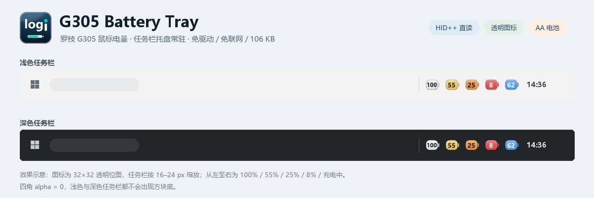
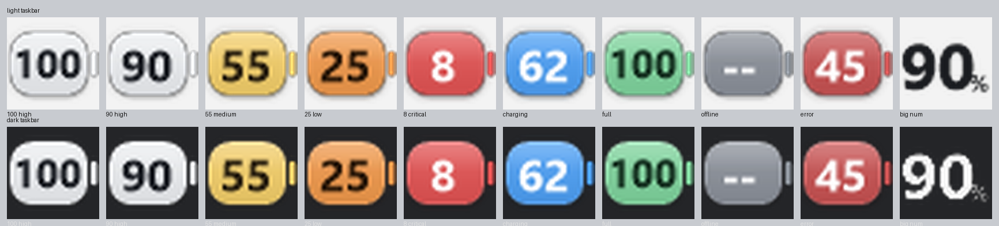
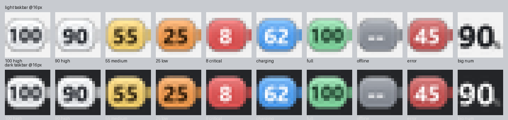
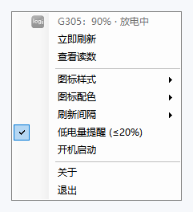
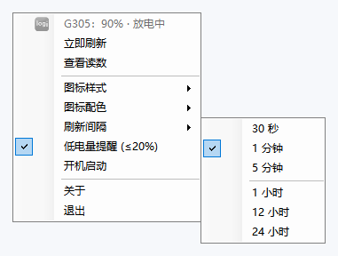
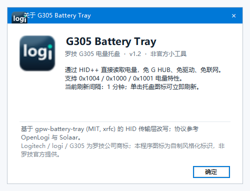
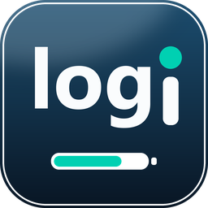
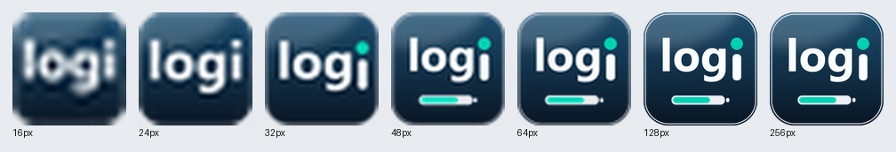

# G305 Battery Tray




[](https://github.com/zhang8686/g305-battery-tray/releases/latest)

> **把罗技 G305 / G305 SE 的剩余电量，常驻显示在 Windows 任务栏托盘里。**
> 一个 106 KB 的绿色单文件程序：不装驱动、不开 G HUB、不联网、不写鼠标任何设置。

## 它解决什么

G305 用一节 AA 电池，电量往往几周才变一档。为了看这一个数字，通常要常驻一整套外设套件。这个小工具只做一件事：定时通过 HID++ 向鼠标问一次电量，把结果画成托盘图标。

图标是**横向圆角电池胶囊 + 大号数字**（`100` / `90` / `25`），四角完全透明，直接融入浅色或深色任务栏；按电量阶段自动换色，带克制的渐变、顶部高光与柔光。鼠标休眠或接收器拔出时显示 `--`。

## 特色亮点

| 亮点 | 说明 |
|---|---|
| **零依赖直读** | 走 Windows 自带 HID 栈读 HID++ 2.0，不需要 G HUB、不需要驱动、不需要联网、不需要管理员权限 |
| **极轻** | 主程序 106 KB，常驻内存约 20 MB，空闲 CPU 趋近于 0；一个进程、无服务、无子进程 |
| **读数来自固件** | `0x1000 batteryStatus` 直接返回百分比，不靠电压曲线估算；兼容 `0x1004 unifiedBattery` 与 `0x1001 batteryVoltage` |
| **透明自适应图标** | 32×32 带 alpha 位图，四角 `alpha=0`；浅色 / 深色任务栏自动切换描边与数字墨色，不会出现方块底 |
| **阶段配色** | 高电量浅白、中段琥珀与橙、低电红、充电蓝、满电绿、离线灰、电池错误暗红 |
| **刷新间隔自由** | 30 秒 / 1 分钟 / 5 分钟 / 1 小时 / **12 小时** / **24 小时**；解锁屏幕、插回接收器、系统唤醒、单击图标都会立即补读 |
| **低电提醒** | ≤20% 弹一次气泡提醒，可关闭 |
| **只读不改** | 不写 DPI、回报率、灯光、配对或固件；本地配置只有一个 52 字节的纯文本 |
| **托盘即界面** | 悬停看状态、单击刷新、双击看完整读数、右键改设置，没有主窗口、没有弹窗广告、没有账号体系 |

## 体积与资源占用

这是本项目最在意的一点：**能少占一点就少占一点。**

| 项目 | 数值 |
|---|---|
| 主程序 `G305Battery.exe` | **108,544 B（106 KB）**，已内嵌多尺寸图标，单文件即可运行；通过 Releases 分发 |
| 最小运行体积 | **106 KB**（一个 exe），无安装包、无外部资源文件 |
| 运行时进程 | 1 个，无后台服务、无子进程、无计划任务 |
| 常驻内存（工作集） | 约 **20 MB**；冷启动瞬间约 36 MB，随后被系统裁剪；私有提交约 22–30 MB |
| 空闲 CPU | 趋近 0，定时器不跑轮询循环，仅查询时有毫秒级占用 |
| 单次电量查询 | 约 0.3–0.5 秒，读完即释放 HID 句柄 |
| 本地配置 | 52 字节，`%APPDATA%\G305Battery\settings.txt` 纯文本 |
| 网络流量 | 0，程序不发起任何网络请求，不采集、不上传数据 |
| 运行依赖 | .NET Framework 4.8（Windows 10 / 11 自带）+ 系统 `hid.dll` / `setupapi.dll` / `kernel32.dll` |
| 权限 | 普通用户即可，无需管理员、无需驱动签名 |
| 开机启动 | 可选且默认关闭，只在「启动」文件夹放一个快捷方式，不写注册表 Run 项 |

> 以上为 Windows 11 / .NET Framework 4.8 环境下的运行测量值；具体数字会随系统版本、DPI 与内存状态略有浮动。

## 界面一览

**电量阶段配色** — 上排浅色任务栏、下排深色任务栏，同一套图标在两种底色下都保持透明与可读：



**16 px 真实托盘尺寸模拟** — 任务栏会把 32×32 图标缩到 16–24 px，数字仍然清晰：



**右键菜单** — 状态、刷新、样式、配色、间隔、提醒、开机启动、关于、退出：

| 主菜单 | 刷新间隔子菜单 |
|---|---|
|  |  |

**关于窗口与应用图标**：

| 关于窗口 | 应用 logo |
|---|---|
|  |  |

**logo 多尺寸对照**（16 / 24 / 32 / 48 / 64 / 128 / 256 px，小尺寸自动简化字标）：



> 任务栏效果图为按真实图标合成的场景示意；菜单、关于窗口、图标均为程序自身控件与资源渲染。

## 快速开始

1. 从 [Releases](https://github.com/zhang8686/g305-battery-tray/releases/latest) 下载 `G305Battery.exe`（106 KB）。
2. 插好 G305 原装 LIGHTSPEED 接收器（`046D:C53F`），鼠标开机。
3. 把 exe 放到一个长期保留的目录，双击运行，托盘出现电量图标——**无需安装**。
4. Windows 可能把新图标收进「隐藏图标」区域，从溢出面板拖到任务栏即可；右键可切换图标样式 / 配色 / 刷新间隔，或开启开机启动。

悬停显示 `G305 90% · 放电中 | 10:53`；**左键单击**立即刷新，**双击**查看完整读数。

## 功能一览

| 能力 | 说明 |
|---|---|
| 图标样式 | 胶囊电池 + 数字（默认）、大号数字 |
| 图标配色 | 跟随系统 / 浅色 / 深色，自动读取 `SystemUsesLightTheme` |
| 刷新间隔 | 30 秒 / 1 分钟（默认）/ 5 分钟 / 1 小时 / 12 小时 / 24 小时 |
| 即时刷新时机 | 启动、单击、双击、菜单刷新、**屏幕解锁与登录**、**插回 LIGHTSPEED 接收器**、系统休眠恢复——均不受间隔限制 |
| 低电提醒 | ≤20% 一次气泡提醒，可关 |
| 单实例 | 是，重复启动只会把请求交给已有实例 |
| 设置持久化 | 主题、样式、提醒开关、间隔写入本地文本 |
| 日志 | 无，不产生日志文件 |

## 电量是怎么读出来的

```
G305 / G305 SE ── LIGHTSPEED 接收器 046D:C53F ── Windows HID（UsagePage 0xFF00）
                            └── HID++ 2.0 电量特性
                                  ├─ 0x1004 unifiedBattery
                                  ├─ 0x1000 batteryStatus   ← G305 主路径
                                  └─ 0x1001 batteryVoltage
```

G305 是一节 AA 电池，固件通过 `0x1000 batteryStatus` **直接给出百分比档位**，不需要用电压曲线反推。程序按上表顺序探测特性索引，并通过 `0x0005 DEVICE NAME` 确认设备名包含 `G305`。HID 报告支持 7 字节短报告与 20 字节长报告，采用独立 overlapped 句柄异步读写、带超时与取消。

全程**只读**：不修改鼠标的 DPI、回报率、灯光、配对或固件设置。

## 常见问题

**百分比为什么跳档，不是连续变化？**
G305 固件上报的是粗粒度档位（例如 90% 的下一档就是 50%），不是连续电量计；与 G HUB 的显示口径可能略有差异。

**图标显示 `--` 怎么办？**
鼠标深度休眠、断电或接收器拔出时 HID++ 无应答。单击托盘图标，或动一下鼠标即可恢复；程序每次查询也会自动重试一次。

**设成 12 / 24 小时会不会漏掉低电提醒？**
定时器只负责周期性查询，低电提醒与换电池后的数值更新最多滞后一个间隔；解锁屏幕、插回接收器、单击图标都会立即补读。想随时确认，单击图标即可。

**支持别的罗技鼠标吗？**
目标是 G305 / G305 SE（AA 电池 + `046D:C53F` 接收器）。`0x1004` / `0x1001` 兼容路径可覆盖部分其它 HID++ 设备，但不作保证。

**深色任务栏能看清吗？**
图标四角透明，浅色任务栏下白胶囊用略深细描边保持可辨，深色任务栏下换浅色细边；也可在「图标配色」里手动指定。

## 源码与构建

源码是单个 C# 文件 `source/G305Battery.cs`，用 Windows 自带的 .NET Framework 编译器即可重新编译，无需 NuGet、无需联网。构建脚本位于 `source/build.ps1`，会把多尺寸 `source/app.ico` 作为图标资源嵌入 exe；应用 logo 由 `source/make_logo.py` 绘制，需要重新设计时运行它即可。

## 仓库结构

```
repo/
├── README.md
├── LICENSE
├── NOTICE.md
├── .gitignore
├── screenshots/          # 8 张界面与图标图
└── source/
    ├── G305Battery.cs    # 全部功能实现
    ├── app.ico           # 内嵌应用图标
    ├── build.ps1
    └── make_logo.py
```

可执行程序在 [Releases](https://github.com/zhang8686/g305-battery-tray/releases/latest) 提供，仓库只保留源码、文档与截图，不提交二进制。

## 来源与许可

HID 设备枚举、overlapped 传输、HID++ 帧归属校验与托盘框架改编自 [gpw-battery-tray](https://github.com/xrfc/gpw-battery-tray)（MIT，Copyright (c) 2026 xrfc）；协议实现参考 [OpenLogi](https://github.com/AprilNEA/OpenLogi)、[Solaar](https://github.com/pwr-Solaar/Solaar) 与[微软 HID 报告文档](https://learn.microsoft.com/en-us/windows-hardware/drivers/hid/obtaining-hid-reports)。详见 [NOTICE.md](NOTICE.md)。

本项目采用 [MIT License](LICENSE)。

> Logitech、logi、G305、LIGHTSPEED、G HUB 均为罗技公司的商标。程序图标与 `source/app.ico` 是本项目自绘的风格化标识，**不是罗技官方 logo**，未使用任何罗技图标资源或品牌素材。本项目为个人非官方工具，与罗技无任何关联或背书。
